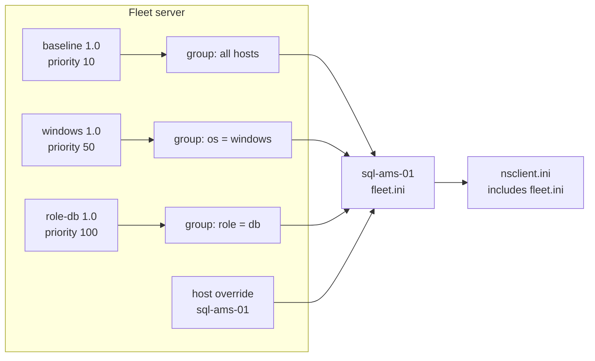

# Configuration Management with NSClient Fleet

**Goal:** Stop editing `nsclient.ini` by hand on every machine. Stand up an
[NSClient Fleet](https://github.com/mickem/nsclient-fleet-server) server, enroll
your agents, and from then on describe the configuration of the whole estate in
one place: a baseline every host gets, a layer per operating system and role on
top of it, and an exception for the one host that needs it.

This works the same on **Windows and Linux**. One fleet server manages both,
and a single bundle can serve a mixed group.

This scenario is about *using* the fleet as a configuration manager. The
mechanics of the server and of enrollment (certificates, tokens, what lands on
disk) are covered step by step in
[Central management with NSClient Fleet](../setup/fleet.md); the steps below
repeat only as much of that as you need to follow along.

---

## How It Works

Three objects on the server decide what a host runs:

| Object | What it is |
|---|---|
| **Bundle** | A named, versioned, signed piece of configuration: an INI fragment and optionally scripts. Versions are immutable. |
| **Group** | A saved rule over host tags (and facts). An empty rule matches every host. |
| **Assignment** | "This bundle version applies to this group", with a **priority**. |

A host receives every bundle assigned to every group it matches. The agent
merges them and writes the result to `fleet.ini`, which its own `nsclient.ini`
includes:



When two layers set the same key, the order is fixed, later wins:

1. Bundles, in **ascending priority** (so the highest number wins).
2. The **host override**, the settings an operator made for that one host.
3. The host's **own `nsclient.ini`**, which outranks everything the fleet sends.

Agents pull; the server never connects to a host. An agent polls on the
interval the server gives it (a host can bound that from its own side with
`min poll interval` and `max poll interval` under `[/settings/fleet]`, see
[Living with it](../setup/fleet.md#step-6-living-with-it)), applies a change
and reloads itself, then
reports the hash of what it applied, which is what the server shows as
**in sync**.

---

## Prerequisites

- A machine with Docker for the fleet server, reachable from every agent on
  one TCP port under a stable DNS name (here `fleet.example.internal:8443`).
- NSClient++ installed on the hosts you want to manage, see
  [Installation](../setup/installing.md).
- Nothing on the agent side to enable: there is no fleet module, and no
  inbound port is opened on the agent.

<!-- @formatter:off -->
!!! danger "A fleet server administers every host enrolled with it"
    A configuration file for NSClient++ can define a script and the command
    line that runs it, so whoever can change configuration on the fleet server
    can run code as `SYSTEM` or `root` on every enrolled machine. That is the
    same trust any configuration manager asks for. Treat the server as a
    production admin host, and read
    [What the fleet server can do to a host](../setup/fleet.md#what-the-fleet-server-can-do-to-a-host)
    before you enroll anything that matters.
<!-- @formatter:on -->

---

## Step 1 — Start the Fleet Server

One container holds the database, the web UI and TLS:

```bash
MASTER_KEY=$(openssl rand -base64 32)   # once; store it in a password manager

docker run -d --name nsclient-fleet --restart unless-stopped \
  -e MASTER_KEY="$MASTER_KEY" \
  -e BASE_URL="https://fleet.example.internal:8443" \
  -e LISTEN_HTTPS=0.0.0.0:8443 \
  -e ON_PREM=true \
  -e ON_PREM_ADMIN_EMAIL=admin@example.internal \
  -e ON_PREM_ADMIN_PASSWORD='a strong password' \
  -v fleet-data:/data \
  -p 8443:8443 \
  ghcr.io/mickem/nsclient-fleet:latest
```

`BASE_URL` is the address the **agents** dial, and its host name ends up in
the certificate they pin, so use the name they resolve, not `localhost`.
`MASTER_KEY` and the `fleet-data` volume cannot be recreated: lose either and
every agent has to be enrolled again.

```bash
curl -k https://fleet.example.internal:8443/healthz    # → OK
```

Out of the box the server issues itself a self-signed certificate. Agents
verify the server during enrollment, so hand them that certificate as a trust
anchor:

```bash
docker cp nsclient-fleet:/data/web-server.crt ./fleet-ca.pem
```

Copy `fleet-ca.pem` to each host you are about to enroll. With a certificate
from your own CA or from Let's Encrypt this file is not needed. Details and
the failure modes: [Give the agents something to trust](../setup/fleet.md#step-2-give-the-agents-something-to-trust).

Sign in at `https://fleet.example.internal:8443/` and create an API key under
**API keys** if you want to script the steps below; everything is also
available in the UI.

---

## Step 2 — Add Hosts, and Tag Them

Tags are what groups select on, so decide them before you enroll: they are
your inventory dimensions. This scenario uses two, `role` and `env`.

Add the host on the server (**Hosts → Add host**), or over the API:

```bash
FLEET=https://fleet.example.internal:8443
KEY=nsk_...

curl -sS --cacert fleet-ca.pem -X POST "$FLEET/api/hosts" \
  -H "Authorization: Bearer $KEY" -H "Content-Type: application/json" -d '{}'
```

```json
{
  "host_id": "01J...",
  "bootstrap_token": "eyJ0eXAiOiJKV1Qi...",
  "install_command": "nscp enroll --server https://fleet.example.internal:8443 --token eyJ0eXAiOiJKV1Qi...",
  "expires_at": 1795000000
}
```

Tag it straight away, before the agent first syncs, so its first
configuration is already the right one:

```bash
curl -sS --cacert fleet-ca.pem -X PUT "$FLEET/api/hosts/01J.../tags/role" \
  -H "Authorization: Bearer $KEY" -H "Content-Type: application/json" \
  -d '{"value": "db"}'
```

Then enroll the agent with the token. It is valid for an hour and for one
use:

=== "Linux"

    ```bash
    sudo install -D -m 0644 fleet-ca.pem /etc/nsclient/security/fleet-ca.pem
    sudo nscp enroll --server https://fleet.example.internal:8443 \
                     --token <bootstrap-token> \
                     --ca /etc/nsclient/security/fleet-ca.pem
    sudo systemctl restart nsclient
    ```

=== "Windows"

    At install time, which leaves `nsclient.ini` empty apart from the fleet
    include, the cleanest starting point for a managed host:

    ```
    msiexec /qn /i NSCP-<version>-x64.msi ^
      FLEET_SERVER=https://fleet.example.internal:8443 ^
      FLEET_TOKEN=<bootstrap-token> ^
      FLEET_CA=C:\path\to\fleet-ca.pem
    ```

    Or on an installed agent, from an elevated prompt:

    ```
    nscp enroll --server https://fleet.example.internal:8443 --token <bootstrap-token> --ca C:\path\to\fleet-ca.pem
    ```

### Operator tags and host-reported tags

There are two kinds of tag, and the difference is a security boundary:

| Kind | Set by | Examples |
|---|---|---|
| **Operator tag** | You, in the UI or with the call above | `role=db`, `env=prod`, `site=ams` |
| **Host-reported tag** | The agent, about itself, on every report | `os` (`windows`, `linux`, `macos`), `hostname`, `nscp_version`, and more from loaded modules such as `os_family` and `arch` |

A group clause reads **operator tags only** unless you explicitly pick
*Host-reported tag* when writing it. A host can claim anything about itself,
so a group over host-reported tags is a group hosts may place themselves in.
That is fine for `os = windows` (the worst a lying host gets is the wrong
checks) and wrong for anything that hands out a credential. Keep groups that
receive secrets or scripts on operator tags.

---

## Step 3 — Design the Layers

Before creating anything, write down which settings belong to everyone and
which to a subset. A layout that scales:

| Layer | Bundle | Group selects | Priority | Holds |
|---|---|---|---|---|
| Baseline | `baseline` | every host (empty rule) | 10 | Modules everyone runs, who may connect, transport |
| Operating system | `windows`, `linux` | host-reported `os` | 50 | Settings whose section differs per platform |
| Role | `role-db`, `role-web`, … | operator tag `role` | 100 | Checks and thresholds for what the host does |
| Exception | host override | one host | always last | The one port, path or threshold that differs |

Two rules keep this manageable:

- **Leave gaps in the priorities.** 10 / 50 / 100 leaves room for a layer you
  have not thought of yet. The default priority is 100.
- **Set each key in as few layers as possible.** Layers that set different
  keys simply add up; priority only matters where two set the same one. The
  fewer of those, the fewer surprises.

---

## Step 4 — Create the Bundles

**Bundles → New bundle.** Pick a template or start empty, give the bundle a
name and a version, and write ordinary INI. Values are written to the agent's
`fleet.ini` exactly as typed.

`baseline` version `1.0`, for every host:

```ini
[/modules]
CheckSystem = enabled
CheckDisk = enabled
CheckHelpers = enabled
NRPEServer = enabled

[/settings/default]
allowed hosts = 10.0.0.10

[/settings/NRPE/server]
port = 5666
```

`windows` version `1.0`:

```ini
[/modules]
CheckEventLog = enabled

[/settings/system/windows/facts]
os = true
hardware = true
```

`linux` version `1.0`:

```ini
[/settings/system/unix/facts]
os = true
hardware = true
```

`role-db` version `1.0`. Database servers sit in their own network segment
and are polled by a different monitoring server, so this layer overrides a key
the baseline also sets:

```ini
[/modules]
CheckMSSQL = enabled

[/settings/default]
allowed hosts = 10.0.0.10, 192.168.50.10
```

<!-- @formatter:off -->
!!! tip "Secrets go in an encrypted bundle"
    A plain bundle is readable by the server and by everyone who can read
    bundles on it. For a password or an API token, tick **Encrypted** when
    creating the bundle: it is sealed in your browser and opened only by
    agents holding the key. See
    [Encrypted bundles](../setup/fleet.md#encrypted-bundles).
<!-- @formatter:on -->

A bundle can also carry the scripts its configuration refers to, so a custom
check and the setting that registers it travel together, see
[Bundles that ship scripts](../setup/fleet.md#bundles-that-ship-scripts).

---

## Step 5 — Create the Groups and Assign the Bundles

**Groups → New group.** Add clauses with the **clause** button; all top-level
clauses must match, and a group with no clauses matches every host.

| Group | Clause | Assigned bundle | Priority |
|---|---|---|---|
| `all-hosts` | *(none)* | `baseline@1.0` | 10 |
| `windows` | Host-reported tag `os` = `windows` | `windows@1.0` | 50 |
| `linux` | Host-reported tag `os` = `linux` | `linux@1.0` | 50 |
| `db-servers` | Operator tag `role` = `db` | `role-db@1.0` | 100 |

**Preview matching hosts** in the group editor lists the hosts a rule selects
right now. Use it before saving: a rule that matches nothing is the usual
reason a bundle "does not arrive".

Then, on each group, pick the bundle under **Assigned bundles**, enter the
priority and press **Assign**. The assignment shows as a chip such as
`baseline@1.0 · p10`.

The same over the API:

```bash
# A bundle from JSON (see "Keeping the configuration in git" for the mapping)
curl -sS --cacert fleet-ca.pem -X POST "$FLEET/api/bundles/compose" \
  -H "Authorization: Bearer $KEY" -H "Content-Type: application/json" \
  -d '{"name": "role-db", "version": "1.0",
       "config_json": {"modules": {"CheckMSSQL": "enabled"},
                       "settings": {"default": {"allowed hosts": "10.0.0.10, 192.168.50.10"}}}}'

# A group over an operator tag
curl -sS --cacert fleet-ca.pem -X POST "$FLEET/api/groups" \
  -H "Authorization: Bearer $KEY" -H "Content-Type: application/json" \
  -d '{"name": "db-servers", "selector": {"clauses": [{"op": "eq", "key": "role", "value": "db"}]}}'

# Assign, using the ids the two calls returned
curl -sS --cacert fleet-ca.pem -X POST "$FLEET/api/groups/<group-id>/bundles" \
  -H "Authorization: Bearer $KEY" -H "Content-Type: application/json" \
  -d '{"bundle_id": "<bundle-id>", "priority": 100}'
```

A clause over a host-reported tag adds `"source": "agent"`.

---

## Step 6 — Verify What a Host Got

**On the server**, open the host. Its **Configuration** card lists every
setting the host's `fleet.ini` will contain, with a **Set by** column naming
the bundle it comes from, lowest priority first. This is the place to answer
"why does this host have that value". For `sql-ams-01`, `allowed hosts` shows
`role-db`, not `baseline`.

The hosts list shows **in sync** once the agent has reported the hash of the
configuration the server would serve it now, and **out of sync** until then.

**On the agent**, the file is plain text:

=== "Linux"

    ```bash
    sudo cat /var/lib/nsclient/fleet/fleet.ini
    ```

=== "Windows"

    ```
    type "C:\Program Files\NSClient++\fleet\fleet.ini"
    ```

    The folder is `${fleet-folder}`. On the opt-in modern
    [file layout](../concepts/file-layout.md) it is
    `C:\ProgramData\NSClient++\fleet` instead.

```ini
; Managed by the fleet sync - DO NOT EDIT, changes are overwritten on the next sync.

[/modules]
CheckDisk=enabled
CheckEventLog=enabled
CheckHelpers=enabled
CheckMSSQL=enabled
CheckSystem=enabled
NRPEServer=enabled

[/settings/NRPE/server]
port=5666

[/settings/default]
allowed hosts=10.0.0.10, 192.168.50.10

[/settings/system/windows/facts]
hardware=true
os=true
```

Four bundles from three layers, merged into one file. The agent reads it
through the include like any other configuration:

```
nscp settings --path /settings/default --key "allowed hosts" --show
10.0.0.10, 192.168.50.10
```

And the agent's log records each apply:

```
fleet Applied fleet configuration 44136fa355b3678a1146ad16f7e8649e94fb4fc21fe77e8310c060f61caaff8a
```

---

## Step 7 — Roll Out a Change, and Roll It Back

Bundle versions are immutable. Editing a bundle in the UI opens
*Edit `name@version` → new version*: you save `baseline@1.1` next to
`baseline@1.0`, and nothing changes on any host until an assignment does.

That gives you a staged rollout for free:

1. Create `baseline@1.1`.
2. Create a group `canary` (operator tag `ring` = `canary`), tag a few hosts,
   and assign `baseline@1.1` to it at priority **11**, just above the
   baseline's 10, so on those hosts 1.1 wins wherever the two differ.
3. Watch the canary hosts go back to **in sync** and check what they report to
   your monitoring.
4. On `all-hosts`, assign `baseline@1.1` and remove the `baseline@1.0` chip.
   Remove the canary assignment.

**To roll back**, assign the older version to the group again and remove the
newer one. Because the old version is still stored and still signed, agents
that have it cached do not even download it again.

Each agent picks a change up on its next poll and reloads itself. Two things
a reload does not do, both by design:

- A module **disabled** by a change keeps running until the service next
  restarts. A newly *enabled* module is loaded at once.
- A key removed from every bundle disappears from `fleet.ini`, and the
  setting falls back to its default or to the host's local value.

---

## Step 8 — Make an Exception for One Host

`sql-ams-01` already has something else listening on 5666. Do not create a
bundle and a group for one machine: open the host, and under
**Configuration** choose **New override**. The editor shows the host's whole
configuration; only what you change is saved.

```ini
[/settings/NRPE/server]
port = 5667
```

The override is merged **after** every bundle, so it wins whatever their
priorities are. It is encrypted at rest on the server, its values stay hidden
in the UI until asked for, and showing them is recorded in the audit log,
which makes it a reasonable place for a host-specific credential too.

<!-- @formatter:off -->
!!! note "Needs NSClient++ 0.25.0 or later on the host"
    Older agents merged the override first and let a bundle setting the same
    key win. The server knows which hosts apply it last and warns on the
    host's page when one does not.
<!-- @formatter:on -->

---

## Local Settings Still Win

A key set in the host's own `nsclient.ini` keeps its local value whatever the
fleet sends. That is deliberate: a host owner can pin something locally, or
opt a host out of one setting, without leaving the fleet. It is also the most
common reason a fleet-managed value "has no effect".

- The agent tells the server *that* it has local configuration, never what it
  is, and the host carries a **local config** badge in the hosts list.
- `nscp enroll` warns when the host it is enrolling already has local
  configuration.
- A Windows install with `FLEET_SERVER` writes nothing to `nsclient.ini` but
  the fleet include, so freshly installed hosts are fully fleet-managed.

To move an existing, hand-configured host under central management, move its
settings into bundles a section at a time and delete them from
`nsclient.ini` as you go. The badge goes away when nothing local is left.

Never edit `fleet.ini`. It is rewritten wholesale on every apply.

---

## Keeping the Configuration in Git

On an on-prem server, groups, bundles and assignments can live in a directory
instead of the database, which gives you review, history and `git revert` for
the configuration of the whole estate.

Export what you built in the UI:

```bash
docker exec nsclient-fleet nsclient-fleet --export-config /data/fleet-config
```

```
fleet-config/
  groups/
    db-servers.json
  bundles/
    baseline/
      1.1/
        config.json
    role-db/
      1.0/
        config.json
        scripts/check_backup.ps1
    secrets/
      1.0.nseb                 an encrypted bundle, as the sealed blob
```

A group file carries its rule and its assignments:

```json
{
  "name": "db-servers",
  "selector": { "clauses": [{ "op": "eq", "key": "role", "value": "db" }] },
  "bundles": [
    { "name": "role-db", "version": "1.0", "priority": 100 }
  ]
}
```

A bundle's `config.json` is the INI fragment as JSON. Each level of the
section path is an object, and the keys of a section are its members, so

```ini
[/modules]
CheckMSSQL = enabled

[/settings/default]
allowed hosts = 10.0.0.10, 192.168.50.10
```

is

```json
{
  "modules": { "CheckMSSQL": "enabled" },
  "settings": {
    "default": { "allowed hosts": "10.0.0.10, 192.168.50.10" }
  }
}
```

Bundles are merged as JSON Merge Patches, which is where one extra ability
comes from: a `null` in a higher-priority bundle **removes** a key a lower
one set, so a role can take back something the baseline gave everyone.

Commit the directory, start the server with `CONFIG_SOURCE_DIR` pointing at
the clone, and the directory is the source of truth: groups, bundles and
assignments become read-only in the UI and API. After a `git pull`, reload
from a deploy hook:

```bash
# What would change?
curl -sS --cacert fleet-ca.pem -X POST "$FLEET/api/config-source/reload" \
  -H "Authorization: Bearer $KEY" -H "Content-Type: application/json" \
  -d '{"dry_run": true}'

# Apply it
curl -sS --cacert fleet-ca.pem -X POST "$FLEET/api/config-source/reload" \
  -H "Authorization: Bearer $KEY" -H "Content-Type: application/json" -d '{}'
```

A directory that does not load changes nothing: the response lists every
problem and agents keep the last configuration that loaded, so a bad commit
cannot take the estate down. A bundle whose contents did not change keeps its
identity across reloads, so agents do not download it again.

Plain bundles are plain files in the repository. Anything secret belongs in an
encrypted bundle, which is committed as its sealed `.nseb` blob and must keep
the exact name and version it was sealed for. Host tags and host overrides
are not part of the directory; they stay with the host on the server.

The server's own
[deployment guide](https://github.com/mickem/nsclient-fleet-server/blob/main/docs/deployment.md)
has the full reference for this mode.

---

## Common Gotchas

### A bundle never reaches a host

The host is not in the group. Open the group and use **Preview matching
hosts**. The usual causes are a tag typed differently on the host and in the
rule, and a clause written as *Operator tag* for a value the host reports
about itself (`os`), or the other way round.

### The host is in sync but the setting is not in effect

Something local outranks it, see [Local Settings Still Win](#local-settings-still-win).
Look for the **local config** badge, then in the host's `nsclient.ini`.

### The wrong layer wins

Open the host's **Configuration** card and read the **Set by** column. Higher
priority numbers win, the host override beats every bundle, and two bundles
at the same priority that set the same key are a conflict you should resolve
by changing one of the priorities rather than relying on the tie-break.

### A module was removed from a bundle and is still running

A reload loads newly enabled modules but does not unload one. Restart the
service on the hosts concerned.

### `[//modules]` in `fleet.ini`

Section names come from the structure of `config.json`. A key written with a
leading slash (`"/modules"`) in a hand-built bundle renders as `[//modules]`,
which matches nothing. Write `"modules"`.

### The host stays *awaiting enrollment*

The sync starts when the service starts. Restart NSClient++ after
`nscp enroll`. If it still does not appear, check that nothing between agent
and server terminates TLS: agents pin the server's certificate, and an
inspecting proxy breaks that.

More enrollment and transport errors, verbatim:
[Troubleshooting](../setup/fleet.md#troubleshooting).

---

## Next Steps

- [Central management with NSClient Fleet](../setup/fleet.md) — the server,
  enrollment, encrypted bundles, script bundles, inventory and failure context
  in full.
- [Settings](../concepts/settings.md) — how includes and paths resolve, which
  is what makes `fleet.ini` ordinary configuration.
- [Host facts](../concepts/facts.md) — the inventory an agent can upload, and
  which groups can also select on.
- [Securing NSClient++](../setup/securing.md) — hardening the agent's own
  listeners, which the settings you now distribute centrally control.
- Any other scenario on this site: the `nsclient.ini` fragments they show are
  exactly what goes into a bundle.
