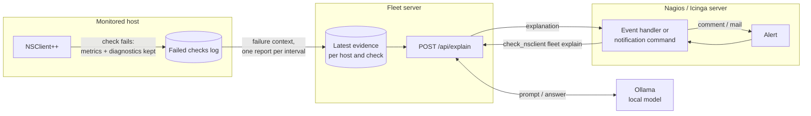

# Explaining Alerts with a Local LLM (Fleet)

**Goal:** When Nagios or Icinga raises an alert, attach an explanation of *why* to it — which process, which service, which directory — written by a language model that runs on your own network, from evidence the NSClient++ agent captured when the check failed. Nothing about the monitored hosts leaves your network.

<!-- @formatter:off -->
!!! tip
    Your monitoring system stays in charge: it raises the alert, decides how serious it is and notifies. The fleet server only adds context. The model is asked to explain one error against the host's evidence, never to judge severity, and it has no tools and no way to act on a host.
<!-- @formatter:on -->
---

## How It Works



1. The **agent** keeps a metrics snapshot and a few diagnostics tables (top processes, services in trouble, recent log errors, directories that usually grow) with every failed check, and sends the newest one to the fleet server as *failure context*.
2. The **fleet server** keeps the latest report per check per host, next to the host's inventory facts. It does nothing with them until somebody asks.
3. When an alert fires, the **monitoring server** runs `check_nsclient fleet explain` with the host, the check and the alert text.
4. The fleet server builds a prompt from the alert and the evidence, sends it to the **local model**, and returns a summary, the relevant evidence, likely causes and suggested next checks.
5. The handler writes that into the monitoring system: a comment on the service, or extra text in the notification.

---

## Prerequisites

* A **fleet server** you run yourself, with the agents enrolled — see [Central management with NSClient Fleet](../setup/fleet.md). The examples assume a single-organisation install (`ON_PREM=true`).
* NSClient++ 0.27.0 or later on the agents: the first release that sends failure context with diagnostics (see [Send failure context](../setup/fleet.md#send-failure-context)).
* A machine for the model that the fleet server can reach. A GPU with 8 GB of memory or more is a comfortable fit for an 8B model; CPU-only works but an explanation can then take longer than the two minutes the fleet server waits.
* On the Nagios / Icinga server: [`check_nsclient`](https://github.com/mickem/check_nsclient) 1.2.0 or later, the first release with `fleet explain`. `jq` is needed for the Nagios comment handler in Step 5 and the Icinga comment handler in Step 6, and a working `mail` command for the notification variants.

---

## Step 1 — Run a Local Model

Install [Ollama](https://ollama.com/) (0.5 or later, for schema-constrained output) on the model machine and pull a model. `llama3.1` is the fleet server's default for this provider:

```
ollama pull llama3.1
```

### Give the model a context window that fits the evidence

A prompt carries up to about 30 KB of evidence — in the order of 10 000 tokens. Ollama's default context window is much smaller than that, and it **truncates a longer prompt silently**: the model then explains the alert from whatever part of the evidence survived. Create a variant of the model with a larger window:

```
cat > Modelfile <<'EOF'
FROM llama3.1
PARAMETER num_ctx 16384
EOF
ollama create llama3.1-explain -f Modelfile
```

Use `llama3.1-explain` as the model name in Step 2. A larger window needs more memory; check with `ollama ps` that the model still loads fully on the GPU.

### Let the fleet server reach it

Ollama listens on `127.0.0.1:11434`. If it runs on the same machine as the fleet server, there is nothing to do. On a machine of its own, make it listen on the network (`OLLAMA_HOST=0.0.0.0:11434` in the Ollama service's environment) and **firewall the port to the fleet server's address** — Ollama has no authentication of its own.

<!-- @formatter:off -->
!!! note "Other local model servers"
    vLLM, llama.cpp's server and most in-house gateways speak the OpenAI Chat Completions format. Use `LLM_PROVIDER=openai` with `LLM_BASE_URL` pointing at the server's `/v1`, and set `LLM_API_KEY` — it is required for this provider, so give a placeholder if your server does not check it.
<!-- @formatter:on -->

---

## Step 2 — Point the Fleet Server at the Model

Add the provider to the fleet server's environment (`/etc/nsclient-fleet/env` on a Linux install, the `environment:` block for a container) and restart it:

```bash
LLM_PROVIDER=ollama
LLM_MODEL=llama3.1-explain
LLM_BASE_URL=http://10.0.0.5:11434
```

| Variable                | Default                  | Notes                                                                                  |
|-------------------------|--------------------------|----------------------------------------------------------------------------------------|
| `LLM_PROVIDER`          | unset (explanations off) | `ollama`, `openai` or `anthropic`. An unknown name fails startup rather than every explanation. |
| `LLM_MODEL`             | `llama3.1` for `ollama`  | Any model the daemon serves.                                                           |
| `LLM_BASE_URL`          | `http://127.0.0.1:11434` | Leave unset when Ollama runs on the fleet server itself.                               |
| `LLM_DAILY_CALL_BUDGET` | unlimited                | Explanations per UTC day. Worth setting once a handler calls this for every alert (Step 5). |

The same can be set from the console under **Settings** (provider `ollama`, the model, the base URL, *Explain errors* on). Two things to know about that path:

* **Saved settings win over the environment.** Once Settings has been saved, the fleet server uses what is stored there — including "off". If explanations stay disabled after setting `LLM_PROVIDER`, look there first.
* A private address in the console's base URL is accepted because of `ON_PREM=true`. A shared, multi-tenant server refuses it unless its operator sets `LLM_ALLOW_PRIVATE_ENDPOINTS=1`.

---

## Step 3 — Capture Evidence on the Agents

Without evidence the model can only rephrase the alert. Turn capture on in `nsclient.ini` — or, better, in a fleet bundle assigned to all hosts, so it is one change for the whole fleet:

```ini
[/settings/core/failed checks]
; Keep the metrics snapshot with each failed check.
capture metrics = true
; Leave out zeros, empty strings and values that restate others: a smaller
; snapshot leaves more of the model's context for what matters.
prune metrics = zeros, empty, duplicates
; Keep the diagnostics tables too.
capture diagnostics = true

; Windows: top processes and services in trouble.
[/settings/system/windows/diagnostics]
processes = true
services = true

; Linux: the same, plus journal errors.
[/settings/system/unix/diagnostics]
processes = true
services = true
errors = true

; Windows: service crash events and recent errors from the event log.
[/settings/eventlog/diagnostics]
services = true
errors = true

; The size of the usual growth spots (temp and log directories, page file).
[/settings/disk/diagnostics]
growth spots = true

[/settings/fleet]
; The shortest time between two failure reports to the fleet server (default 1h).
failure context interval = 5m
```

A section for a platform the host is not on is unused, so one bundle serves a mixed fleet.

| Setting                    | Why this value                                                                                                             |
|----------------------------|----------------------------------------------------------------------------------------------------------------------------|
| `capture metrics`          | The numbers: *how much*. Without it the explanation's confidence is usually `low`.                                         |
| `capture diagnostics`      | The names: *what*. This is what lets an explanation say `acme-indexer.exe` instead of "a process".                         |
| `failure context interval` | The agent sends **at most one report per interval**, not one per failed check. The interval is a wait *after* a report: the first failure on a quiet host goes out on the next poll, and a host that has just reported holds the next one until the interval has passed. At the default of an hour, a second alert within the hour is explained against the picture from the first. Five minutes keeps the evidence close to the alert. |

<!-- @formatter:off -->
!!! warning "What leaves the host"
    The tables carry process names, service names with their executable and account, directory paths and the text of recent log errors — never a command line. That goes to the fleet server (stored encrypted) and, when someone asks for an explanation, to the model. With a local model it stays on your network; keep that in mind before switching the provider to a hosted one. `prune pattern` keeps named metrics and tables on the host.
<!-- @formatter:on -->

Confirm evidence arrives: make a check fail on one host, wait one interval, and open the host's **Context** tab in the fleet console. The failed check should be listed with its snapshot and tables. Paste an error and press **Explain** there to test Steps 1–3 before involving the monitoring server.

---

## Step 4 — Connect the Monitoring Server

Create a key for the monitoring server under **API keys** in the fleet console. A key acts as its owner, and any role may ask for explanations, so use one that belongs to a `view_only` user where your install has several users. A single-organisation install (`ON_PREM=true`) has one administrator, and the key is theirs: it can change configuration too, so guard the file below accordingly.

On the monitoring server, store the URL and key where the handler scripts can read them. An environment file works on a headless server, where no keyring is available to the `nagios` or `icinga` user:

```
sudo install -d -m 0750 -o root -g nagios /etc/nsclient
sudo tee /etc/nsclient/fleet.env >/dev/null <<'EOF'
export FLEET_URL=https://fleet.example.com
export FLEET_API_KEY=nsk_...
EOF
sudo chown root:nagios /etc/nsclient/fleet.env
sudo chmod 640 /etc/nsclient/fleet.env
```

(Use the `icinga` group on an Icinga 2 server. `check_nsclient fleet login --url ... --ca ...` stores a profile in the system keyring instead, and is also how you add a private CA; run it as the user that runs the checks.)

Try it as that user:

```
sudo -u nagios sh -c '. /etc/nsclient/fleet.env; check_nsclient fleet explain --host winsrv01 --check disk_c "CRITICAL: C:\ used 95.2% > 90%"'
winsrv01: The system drive is essentially full; the IIS log directory accounts for most of the growth.

Relevant evidence:
  - C:\ used = 95.2% against a critical threshold of 90%
  - disk.growth_spots: C:\inetpub\logs is 61 GB

Likely causes:
  - IIS logs in C:\inetpub\logs have not been rotated

Suggested checks:
  - Check the age of the files under C:\inetpub\logs

Based on:
  - check: check_drivesize (disk_c), CRITICAL 4 minutes ago
  - snapshot: 521 metrics, reported 4 minutes ago with check_drivesize (disk_c)
  - facts: agent

Confidence: high. Written by ollama/llama3.1-explain; check it against the evidence before acting on it.
```

How the three arguments are used:

| Argument  | Meaning                                                                                                                                                 |
|-----------|---------------------------------------------------------------------------------------------------------------------------------------------------------|
| `--host`  | The hostname **as the fleet knows it**, or the fleet's host id. If Nagios calls the host something else, map it (a custom variable, see Customisation). |
| `--check` | The agent's command (`check_drivesize`) or alias (`disk_c`), as shown on the agent's **Failed checks** page. A name that matches nothing is not second-guessed: the explanation then has no check report to go on. |
| the error | The alert text: the remaining words, or standard input when there are none. Without `--check`, a command or alias that appears in this text is matched instead. In a handler, pipe the text in rather than passing it as an argument, so that output starting with a dash cannot be read as an option. |

So pass `--check` when your service names are the agent's aliases (as they are with [polled passive checks](nagios-result-cache.md) and scheduled passive checks), and leave it out when they are not — put the service name in the error text and let the fleet server look for a match.

---

## Step 5 — Enrich Nagios

An **event handler** runs when a service changes state. This one asks for an explanation when a problem becomes a hard state and files it as a comment on the service, where it shows in the web UI next to the alert.

`/usr/local/nagios/libexec/eventhandlers/fleet-explain`:

```sh
#!/bin/sh
# fleet-explain <host> <service> <state> <statetype> <output>
[ "$4" = "HARD" ] || exit 0
[ "$3" = "OK" ] && exit 0
. /etc/nsclient/fleet.env
CMDFILE=/usr/local/nagios/var/rw/nagios.cmd

# In the background: a local model can take longer than Nagios lets an
# event handler run (event_handler_timeout, 30 seconds by default).
(
    answer=$(check_nsclient --output json fleet explain \
        --host "$1" --check "$2" "$2 is $3: $5") || exit 0
    # A Nagios comment is one line.
    text=$(printf '%s' "$answer" | jq -r '
        [.explanation.summary]
        + (.explanation.likely_causes | map("Likely cause: " + .))
        + (.explanation.suggested_checks | map("Check: " + .))
        + ["(" + .explanation.confidence + " confidence, written by " + .model + ")"]
        | join(" | ")' | tr -d '\n')
    printf '[%s] ADD_SVC_COMMENT;%s;%s;0;fleet;%s\n' \
        "$(date +%s)" "$1" "$2" "$text" > "$CMDFILE"
) >/dev/null 2>&1 &
```

```
define command {
    command_name    fleet-explain
    command_line    $USER1$/eventhandlers/fleet-explain "$HOSTNAME$" "$SERVICEDESC$" "$SERVICESTATE$" "$SERVICESTATETYPE$" "$SERVICEOUTPUT$"
}

define service {
    name                    explained-service
    use                     generic-service
    event_handler           fleet-explain
    event_handler_enabled   1
    register                0
}
```

Use `explained-service` as the template for the services you want explained. `nagios.cfg` needs `enable_event_handlers=1` and `check_external_commands=1`. The comment is non-persistent (`0`): Nagios drops it at its next restart, not when the service recovers. Make it `1` to keep it across restarts, and delete old ones from the web UI.

### In the notification instead

To put the explanation in the mail, wrap the notification command. The explanation is added to problem notifications only, and the mail is sent without it if the fleet server or the model does not answer in time:

`/usr/local/nagios/libexec/notify-service-explained`:

```sh
#!/bin/sh
# notify-service-explained <type> <host> <service> <state> <output> <email>
. /etc/nsclient/fleet.env
body="$1: $3 on $2 is $4

$5"
if [ "$1" = "PROBLEM" ]; then
    why=$(timeout 110 check_nsclient fleet explain --host "$2" --check "$3" "$3 is $4: $5") \
        && body="$body

--- Explanation ---
$why"
fi
printf '%s\n' "$body" | mail -s "** $1: $2/$3 is $4 **" "$6"
```

```
define command {
    command_name    notify-service-explained
    command_line    $USER1$/notify-service-explained "$NOTIFICATIONTYPE$" "$HOSTNAME$" "$SERVICEDESC$" "$SERVICESTATE$" "$SERVICEOUTPUT$" "$CONTACTEMAIL$"
}
```

Set `notification_timeout=120` in `nagios.cfg` (the default of 30 seconds is shorter than a slow explanation), and use the command as the contact's `service_notification_commands`.

---

## Step 6 — Enrich Icinga 2

### In the notification mail

A `NotificationCommand` that asks for the explanation and mails it with the alert. This script and the configuration below are the ones in the repository under [`build/powershell/icinga/explained/`](https://github.com/mickem/nscp/tree/main/build/powershell/icinga/explained), which are run end to end against a real Icinga 2 server and fleet server as a test; the only change here is the path of the environment file.

`/etc/icinga2/scripts/mail-service-explained.sh`:

```bash
#!/bin/bash
# Mails a service notification. For problems, asks the fleet server to
# explain the error first. The mail goes out explained or not.
set -u

. /etc/nsclient/fleet.env
export FLEET_URL FLEET_API_KEY

explanation=""
if [ "$NOTIFICATIONTYPE" = "PROBLEM" ]; then
    # Optional head start for the agent's failure report (see below).
    sleep "${EXPLAIN_SETTLE:-0}"

    # The error goes in on stdin, so odd characters cannot be read as options.
    if out=$(printf '%s' "$SERVICEOUTPUT" | head -c 4000 |
             timeout 150 /usr/local/bin/check_nsclient fleet --timeout-s 120 \
                 explain --host "$FLEET_HOST" --check "$SERVICENAME" 2>&1); then
        explanation="$out"
    else
        explanation="No explanation available: $out"
    fi
fi

{
    echo "When:   $LONGDATETIME"
    echo "Output: $SERVICEOUTPUT"
    if [ -n "$explanation" ]; then
        echo
        echo "---- Why (model-written, from fleet evidence) ----"
        echo "$explanation"
    fi
} | mail -s "[$NOTIFICATIONTYPE] $SERVICENAME on $HOSTNAME is $SERVICESTATE" "$USEREMAIL"
```

```cfg
object NotificationCommand "mail-service-explained" {
  command = [ ConfigDir + "/scripts/mail-service-explained.sh" ]
  timeout = 4m

  env = {
    NOTIFICATIONTYPE = "$notification.type$"
    HOSTNAME         = "$host.name$"
    FLEET_HOST       = "$fleet_host$"
    SERVICENAME      = "$service.name$"
    SERVICESTATE     = "$service.state$"
    SERVICEOUTPUT    = "$service.output$"
    LONGDATETIME     = "$icinga.long_date_time$"
    USEREMAIL        = "$user.email$"
    EXPLAIN_SETTLE   = "$explain_settle$"
  }

  /* Defaults; a host or service can override either with its own vars. */
  vars.fleet_host     = "$host.name$"
  vars.explain_settle = 0
}

apply Notification "mail-explained" to Service {
  command  = "mail-service-explained"
  users    = [ "icingaadmin" ]
  states   = [ Warning, Critical, Unknown ]
  types    = [ Problem, Recovery ]
  interval = 0          /* one mail per problem, so one model call */

  assign where host.vars.nscp_passive == true
}
```

Adjust the `assign where` rule to the services you want explained, and reload Icinga 2. Three things in it are deliberate:

* **`timeout = 4m`** leaves room for the 120 seconds the fleet server waits on the model, on top of the settle time. Icinga's default of one minute would kill the script before a slow model answers.
* **`interval = 0`** sends one mail per problem rather than a reminder every half hour, so a problem costs one model call.
* **`vars.fleet_host`** is the name the fleet server knows the host by. Set it on a host whose Icinga name differs; `vars.explain_settle` (seconds) delays the question on a host or service whose evidence tends to arrive after the alert.

<!-- @formatter:off -->
!!! note "Passive services in Icinga 2"
    When the services are fed by the [Icinga 2 passive client](passive-monitoring-icinga.md), two details decide whether a notification is sent at all. Passive results count as check attempts, so with the `generic-service` template's `max_check_attempts = 5` the notification waits for the fifth failed result in a row; set it on the service to what you want. And Icinga 2 has no `check_freshness` attribute: leave active checks enabled with `check_command = "dummy"` and a `check_interval` of about twice the agent's, so a host that stops reporting turns UNKNOWN on its own. The repository's [`nscp-passive.conf`](https://github.com/mickem/nscp/blob/main/build/powershell/icinga/explained/nscp-passive.conf) has both.
<!-- @formatter:on -->

### As a comment instead

The same question from an `EventCommand`, filing the explanation as a comment through the Icinga 2 API. Comments show on the service in Icinga Web and may span several lines, so the text output is used as it is. This variant is not part of the repository's test.

An API user that may only add comments:

```cfg
object ApiUser "fleet-explain" {
    password = "secret-password"
    permissions = [ "actions/add-comment" ]
}
```

`/etc/icinga2/scripts/fleet-explain.sh` (add `ICINGA_API_USER` and `ICINGA_API_PASSWORD` to `/etc/nsclient/fleet.env`):

```sh
#!/bin/sh
[ "$SERVICESTATETYPE" = "HARD" ] || exit 0
[ "$SERVICESTATE" = "OK" ] && exit 0
. /etc/nsclient/fleet.env

why=$(printf '%s' "$SERVICENAME is $SERVICESTATE: $SERVICEOUTPUT" |
    check_nsclient fleet explain --host "$HOSTNAME" --check "$SERVICENAME") || exit 0

jq -n --arg h "$HOSTNAME" --arg s "$SERVICENAME" --arg c "$why" '{
    type: "Service",
    filter: "host.name == hn && service.name == sn",
    filter_vars: { hn: $h, sn: $s },
    author: "fleet",
    comment: $c
}' | curl -s -o /dev/null \
    --cacert /var/lib/icinga2/certs/ca.crt \
    -u "$ICINGA_API_USER:$ICINGA_API_PASSWORD" \
    -H 'Accept: application/json' \
    -X POST 'https://localhost:5665/v1/actions/add-comment' -d @-
```

```cfg
object EventCommand "fleet-explain" {
    command = [ ConfigDir + "/scripts/fleet-explain.sh" ]
    // A local model can take a while; the default is one minute.
    timeout = 3m
    env = {
        HOSTNAME         = "$host.name$"
        SERVICENAME      = "$service.name$"
        SERVICESTATE     = "$service.state$"
        SERVICESTATETYPE = "$service.state_type$"
        SERVICEOUTPUT    = "$service.output$"
    }
}

template Service "explained-service" {
    event_command = "fleet-explain"
}
```

Import `explained-service` into the services you want explained (`import "explained-service"` in the service or apply rule) and reload Icinga 2. This works the same for services fed by the [Icinga 2 passive client](passive-monitoring-icinga.md): the event command runs on the Icinga side whenever the state changes, however the result arrived.

---

## Step 7 — Verify

1. Force a failure on a test host — for example a threshold that cannot pass: `check_drivesize drive=c: critical=used>1%` as the service's check.
2. Wait for the agent to report it (its next poll of the fleet server, or the rest of the `failure context interval` if it reported recently) and for the monitoring system to reach a hard state.
3. The service gets a comment by `fleet`, or the notification mail carries the explanation: an *Explanation* section from the Nagios script, a *Why* section from the Icinga one.

The Icinga notification path can also be run as a scripted test against machines in Azure: `setup-icinga-explained-alerts.ps1`, `configure-explained-agents.ps1` and `verify-icinga-explained.ps1` under `build/powershell/icinga/` set it up, break a disk check and read the mail. See *Explained alerts* in [`build/powershell/README.md`](https://github.com/mickem/nscp/blob/main/build/powershell/README.md).

When nothing appears, run the handler's `check_nsclient` line by hand as the `nagios` / `icinga` user. The fleet server's reason is printed as it was given:

| Message                                                    | Meaning                                                                                                   |
|------------------------------------------------------------|-----------------------------------------------------------------------------------------------------------|
| `no host named 'x' (404)`                                  | The monitoring system's host name is not the fleet's. Pass the fleet's name or id.                         |
| `N hosts are named 'x'; name one by id (409)`              | The hostname is not unique in the fleet. Use the id.                                                      |
| `explanations are not enabled for this tenant (409)`       | No `LLM_PROVIDER`, or the console's Settings are saved with explanations off (Step 2).                     |
| `this tenant's daily budget ... is spent (429)`            | `LLM_DAILY_CALL_BUDGET` or the console's budget is used up until midnight UTC.                            |
| `could not reach the model provider (502)`                 | Ollama is down, not listening on that address, or firewalled.                                             |
| `the model provider rejected the request (404) (502)`      | The model name is not one the daemon serves — check `ollama list`.                                        |
| `the model's answer could not be read (502)`               | The model did not produce the requested structure. Try again, or use a larger model.                      |
| A timeout                                                  | The model is too slow for this hardware. The fleet server gives up after two minutes.                     |

---

## Expected Output

| Situation                                        | Explanation                                                                                              |
|--------------------------------------------------|----------------------------------------------------------------------------------------------------------|
| Evidence captured, check matched                 | Names the cause from the tables; `Based on` lists the check, the snapshot and the facts; confidence `high` or `medium` |
| `capture metrics` off                            | `snapshot: none on file for this host`; confidence usually `low`                                         |
| `capture diagnostics` off, or no tables enabled  | Describes the reading ("CPU is at 97%") without naming what caused it                                    |
| `--check` does not match a reported check        | `check: no reported check matched the error`; the newest snapshot of the host is still used              |
| Host never reported a failure                    | Explained from the alert text and the inventory facts alone                                              |
| Explanation is vague although evidence is listed | The prompt was cut by the model's context window — see below                                             |

To see whether the context window is large enough, look at `input_tokens` in the JSON output (`check_nsclient --output json fleet explain ...`). A value that sits exactly at the model's context size, the same for every host, means the prompt was truncated: raise `num_ctx` (Step 1).

---

## Customisation

**Host names that differ.** When the monitoring system's host name is not the name the agent enrolled with, carry the fleet name in a custom variable and pass that: `$_HOSTFLEET_NAME$` in Nagios (`_FLEET_NAME` on the host), `vars.fleet_host` on the host in Icinga 2 (the notification command in Step 6 reads it).

**Only some services.** Explanations help most where the cause is on the host: CPU, memory, disk, services, event log. Leave the template off network reachability checks — a host that is down has reported nothing new.

**Budget.** With a handler, every hard problem state is a model call. On your own hardware the cost is time, but a flapping service still queues requests behind each other. `LLM_DAILY_CALL_BUDGET` caps the total, and Nagios / Icinga flap detection keeps the handler quiet for a flapping service.

**A different model.** Any model the daemon serves can be named in `LLM_MODEL`. Larger models follow the evidence more reliably; smaller ones answer faster. Whichever you pick, give it the context window from Step 1.

**From a script or a ticketing hook.** `some-alert-hook | check_nsclient fleet explain --host web01` reads the error from standard input, and `--output json` returns the answer as fields. The REST call underneath is `POST /api/explain` on the fleet server.

**Treat it as a hint.** The explanation is model-written text, and the evidence it reads includes log messages and service names that software on the host chose. Show it next to the alert; do not let anything act on it.

---

## Next Steps

- [Central management with NSClient Fleet](../setup/fleet.md) — running the server, enrolling agents, bundles and failure context in detail
- [Failed checks](../api/rest/failures.md) — the log the evidence comes from, pruning and size budgets
- [Diagnostics](../api/rest/diagnostics.md) — every table, its columns and the switch that turns it on
- [Explaining errors](https://github.com/mickem/nsclient-fleet-server/blob/main/docs/explaining-errors.md) — the fleet server's reference: providers, privacy and prompt-injection posture, the `/api/explain` API
- [Polled Passive Checks (Nagios Core)](nagios-result-cache.md) and [Passive Monitoring (Icinga 2)](passive-monitoring-icinga.md) — setups where service names are the agent's aliases, so `--check` matches without mapping
