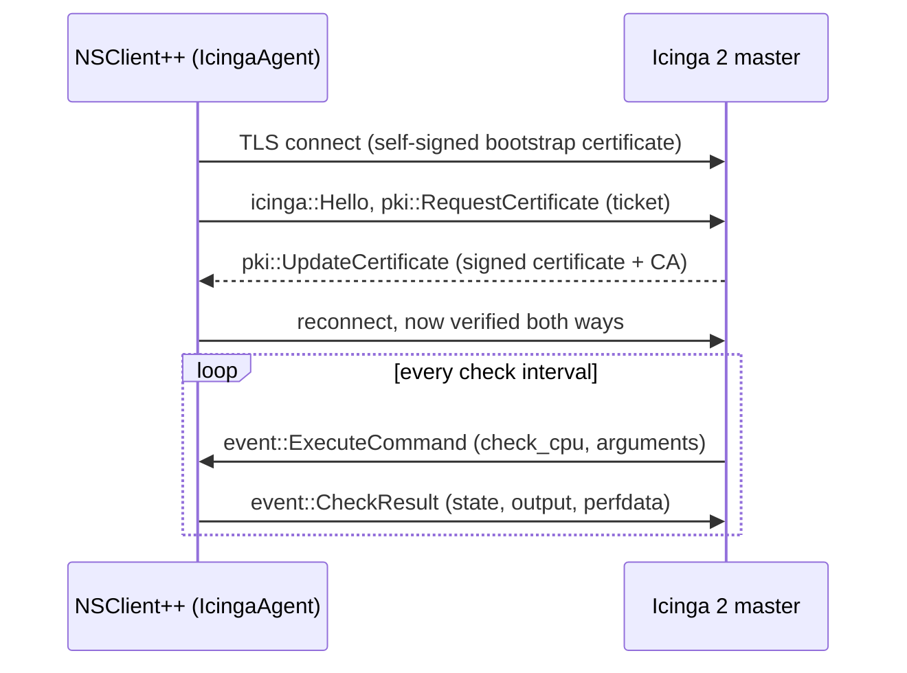

# Native Icinga 2 Agent

**Goal:** Let an Icinga 2 master (or satellite) schedule checks on NSClient++ exactly as it does on an Icinga agent -
`command_endpoint`, certificates from the Icinga CA, results in Icinga within seconds - without installing `icinga2` or
Icinga for Windows on the host.

<!-- @formatter:off -->
!!! warning "Experimental"
    The `IcingaAgent` module is new and marked experimental: its settings and behaviour may still change. The
    protocol follows the PowerShell-only Icinga for Windows (v27), which talks to Icinga 2 the same way.
<!-- @formatter:on -->

---

## How it works

NSClient++ connects out to the master on port `5665` and keeps the connection open. The master sends each check as an
`event::ExecuteCommand`, the agent runs the matching NSClient++ query and sends the result straight back:



Compared with the alternatives:

| Approach                                              | Who connects            | Certificates      | Checks configured on |
|-------------------------------------------------------|-------------------------|-------------------|----------------------|
| `IcingaAgent` (this page)                             | Agent → master          | Icinga CA         | Master               |
| [NRPE](nrpe.md) / `check_nscp_api`                    | Master → agent          | Your own          | Master               |
| [Passive (IcingaClient)](passive-monitoring-icinga.md) | Agent → master REST API | Icinga API user   | Agent (Scheduler)    |

---

## Prerequisites

- An Icinga 2 master with the API feature enabled (`icinga2 node wizard` / `node setup --master` does this). The
  `ifw-api` check command used below needs **Icinga 2.14** or later.
- Outbound TCP `5665` from the agent to the master.
- On the agent:

```ini
[/modules]
IcingaAgent = enabled
CheckSystem = enabled   ; check_cpu, check_memory, check_uptime, check_process, ...
CheckDisk = enabled     ; check_drivesize
```

On Windows, the module is the *Icinga 2 agent* feature of the installer.

---

## Step 1 — Tell the master about the agent

Each agent is an `Endpoint` in a `Zone` of its own, whose parent is the master's zone (`master` after
`node setup --master`). Leave `host` out: the agent connects to the master, not the other way round.

```icinga2
// /etc/icinga2/zones.conf
object Endpoint "win-host-01" { }

object Zone "win-host-01" {
  endpoints = [ "win-host-01" ]
  parent = "master"
}
```

The endpoint name is the agent's identity: its certificate is issued for it, and the agent's `endpoint name` setting
must match it.

---

## Step 2 — Define the check commands

The master holds the check definitions. Import `ifw-api` into each `CheckCommand`: the master then sends the
NSClient++ query name (the command's own name, unless `vars.ifw_api_command` says otherwise) and its arguments, and the
agent builds the command line. Arguments are passed to the query as `key=value`:

```icinga2
// /etc/icinga2/zones.d/master/nscp-commands.conf
object CheckCommand "check_cpu" {
  import "ifw-api"
  vars.ifw_api_arguments = {
    "warning"  = { value = "$nscp_cpu_warning$" }
    "critical" = { value = "$nscp_cpu_critical$" }
    "time"     = { value = "$nscp_cpu_time$" }
  }
}

object CheckCommand "check_memory" {
  import "ifw-api"
  vars.ifw_api_arguments = {
    "warning"  = { value = "$nscp_mem_warning$" }
    "critical" = { value = "$nscp_mem_critical$" }
    "type"     = { value = "$nscp_mem_type$" }
  }
}

// An Icinga name that differs from the NSClient++ query.
object CheckCommand "nscp-disk" {
  import "ifw-api"
  vars.ifw_api_command = "check_drivesize"
  vars.ifw_api_arguments = {
    "drive"    = { value = "$nscp_disk_drive$" }
    "warning"  = { value = "$nscp_disk_warning$" }
    "critical" = { value = "$nscp_disk_critical$" }
    "show-all" = { set_if = "$nscp_disk_show_all$" }
  }
}
```

The argument values are NSClient++ filter expressions, as on any other transport. A list value repeats its key
(`time=5s time=1m`); `set_if` turns a boolean into a flag; an argument whose variable is not set is left out.

### One command for every query

To write the arguments in NSClient++'s own syntax instead, define one generic command and pass the tokens as a list -
the same tokens you would give `check_nrpe -a` or the REST API:

```icinga2
object CheckCommand "nscp-query" {
  import "ifw-api"
  vars.ifw_api_command = "$nscp_query$"
  vars.ifw_api_arguments = {
    "(arguments)" = { value = "$nscp_arguments$", skip_key = true }
  }
}
```

Icinga reads `$` as the start of a macro, so NSClient++'s `${keyword}` is written `$${keyword}` (see the `top-syntax`
below). The name `nscp` is taken by Icinga's own command library, hence `nscp-query`.

---

## Step 3 — Host and services

Point the services at the agent with `command_endpoint`. The `cluster-zone` check keeps the host UP while the agent is
connected:

```icinga2
// /etc/icinga2/zones.d/master/win-host-01.conf
object Host "win-host-01" {
  check_command = "cluster-zone"
  vars.cluster_zone = name
}

template Service "nscp-agent-service" {
  host_name = "win-host-01"
  command_endpoint = "win-host-01"
}

object Service "cpu" {
  import "nscp-agent-service"
  check_command = "check_cpu"
  vars.nscp_cpu_warning = "load > 80"
  vars.nscp_cpu_critical = "load > 95"
  vars.nscp_cpu_time = [ "5m", "15m" ]
}

object Service "memory" {
  import "nscp-agent-service"
  check_command = "check_memory"
  vars.nscp_mem_warning = "used > 90%"
  vars.nscp_mem_critical = "used > 98%"
  vars.nscp_mem_type = "physical"
}

object Service "disk c" {
  import "nscp-agent-service"
  check_command = "nscp-disk"
  vars.nscp_disk_drive = "C:"
  vars.nscp_disk_warning = "used > 90%"
  vars.nscp_disk_critical = "used > 95%"
}

object Service "nscp running" {
  import "nscp-agent-service"
  check_command = "nscp-query"
  vars.nscp_query = "check_process"
  vars.nscp_arguments = [ "process=nscp.exe", "critical=count < 1", "top-syntax=%(status): $${list}" ]
}
```

Validate and reload: `icinga2 daemon -C && systemctl reload icinga2`.

---

## Step 4 — Configure and start the agent

Issue a ticket for the agent on the master:

```
icinga2 pki ticket --cn win-host-01
```

Then, on the agent:

```ini
[/settings/Icinga/agent]
parent host = icinga-master.example.com
parent endpoint = icinga-master            ; the CN of the master's certificate
endpoint name = win-host-01                ; the Endpoint object from step 1
ticket = 9f6c1d...                         ; from `icinga2 pki ticket`
```

Restart NSClient++. The log shows the bootstrap:

```
Icinga agent: no CA at .../icinga/ca.crt yet, the parent's certificate is NOT verified on this connection; no checks run until it is
Icinga agent: the `ticket` is sent over this unverified connection, to whoever answers at icinga-master.example.com:5665. ...
Icinga agent: Connected to Icinga endpoint 'icinga-master' at icinga-master.example.com:5665
Icinga agent: stored the certificate signed by the Icinga CA in .../icinga/win-host-01.crt
Icinga agent: Disconnected from icinga-master.example.com: Received a signed certificate, reconnecting with it
Icinga agent: Connected to Icinga endpoint 'icinga-master' at icinga-master.example.com:5665
```

The key, the signed certificate and the Icinga CA are kept in `certificate directory` (default
`${certificate-path}/icinga`); the key is readable only by the account NSClient++ runs as. The ticket is only needed
for this first signing.

**Without a ticket**, the request waits on the master. List and sign it there:

```
icinga2 ca list
icinga2 ca sign <fingerprint>
```

The agent picks the signed certificate up on its next connection.

### Trusting the master on the first connection

Icinga has no public CA: every installation creates its own on the master. Until the agent holds it, it cannot verify
the master - the situation `icinga2 node setup` is in without `--trustedcert`. Pick one of:

**Install the CA up front (recommended for deployments).** Copy the master's CA certificate - the certificate only,
never `ca.key` - to the agent before its first start:

```
/var/lib/icinga2/certs/ca.crt   (on the master)
  ->  <certificate directory>/ca.crt   (on the agent, default ${certificate-path}/icinga/ca.crt)
```

The agent then verifies the master from the very first connection and runs checks on it.

**Pin the master's certificate.** Print its fingerprint on the master and put it in the agent's configuration - one
line, convenient for an install command:

```
openssl x509 -noout -fingerprint -sha256 -in /var/lib/icinga2/certs/icinga-master.crt
SHA256 Fingerprint=3C:91:...:7A
```

```ini
[/settings/Icinga/agent]
parent fingerprint = 3C:91:...:7A
```

The pin is only used until the agent has the CA; after that the master is verified against the CA, so renewing the
master's certificate does not break the agent.

**Trust on first use (the default).** With neither, the first connection is not verified. The agent runs no checks on
it; it only asks for its certificate and stores the CA the master returns. To forbid this - and refuse to connect until
a CA or a pin is in place - set `trust on first use = false`.

<!-- @formatter:off -->
!!! danger "An unverified first connection sends the ticket to whoever answers"
    Without the CA or a pin the agent cannot tell the master from anyone else at `parent host` - a machine on the
    path, a poisoned DNS record, a mistyped address - and it sends the ticket in its first message. A ticket does not
    expire and is not used up: whoever holds it can have the real master sign a certificate for this endpoint name
    and connect to the master **as this agent**, reporting results for the host and receiving its checks. The same
    peer can answer with a CA of its own, which the agent then trusts as its parent's and runs checks for.

    Use trust on first use only on a network you trust for that one connection. Everywhere else install `ca.crt` or
    set `parent fingerprint`, and set `trust on first use = false`. If a ticket may have leaked, change `TicketSalt`
    on the master: that invalidates every ticket it has issued, which is the only way to withdraw one, but it does
    not revoke a certificate that was already signed with it.
<!-- @formatter:on -->

In every case a master whose certificate is not for `parent endpoint` is refused, even when the same CA signed it.

---

### Certificate renewal

Nothing to do. Icinga issues the agent's certificate for 397 days and renews it - same key, no new ticket - once the
agent asks within 30 days of expiry. The agent asks on every connection and once a day on a connection that stays up
(`certificate request interval`), stores the renewed certificate and reconnects with it:

```
Icinga agent: stored the certificate signed by the Icinga CA in .../icinga/win-host-01.crt
Icinga agent: Disconnected from icinga-master.example.com: Received a signed certificate, reconnecting with it
```

A CA renewed on the master reaches the agent the same way.

---

## Step 5 — Restrict what the master may run

Every check runs as `IcingaAgent:<parent endpoint>` in the core permission policy. The policy is off by default, so a
verified master can run any query. Turn it on and grant the checks the master actually uses:

```ini
[/settings/permissions]
enabled = true

[/settings/permissions/policies]
IcingaAgent:icinga-master = CheckSystem.*, CheckDisk.check_drivesize
```

A check outside the grant comes back to Icinga as `UNKNOWN: Permission denied: IcingaAgent:icinga-master is not
allowed to run ...`. To refuse arguments altogether - only argument-less queries and aliases defined on the agent -
set `allow arguments = false` under `/settings/Icinga/agent`. See [Permissions](../concepts/permissions.md) for the
pattern syntax and the observe-then-enforce rollout.

---

## Expected output

In Icinga Web 2 (or `GET /v1/objects/services`), each service shows `check_source` = the agent's endpoint name and the
NSClient++ output and performance data:

```
cpu           OK        OK: CPU load is ok.                    'total 5m'=3%;80;95 'total 15m'=2%;80;95
memory        OK        OK: physical = 6.2GB                   'physical'=6.2GB;14.1;15.3;0;15.7 'physical %'=39%;90;98;0;100
disk c        OK        OK C:\: 61GB/237GB used                'C:\ used'=61GB;213;225;0;237 'C:\ used %'=25%;90;95;0;100
nscp running  OK        OK: nscp.exe=started                   'count'=1;0;1
```

The host stays UP while the agent is connected (`Zone 'win-host-01' is connected`).

---

## Troubleshooting

| Symptom                                                        | Cause and fix                                                                                                    |
|----------------------------------------------------------------|------------------------------------------------------------------------------------------------------------------|
| `` `parent endpoint` is not set ... refusing to connect ``      | Set `parent endpoint` to the CN of the master's certificate.                                                     |
| `Parent presented the certificate of 'x', expected 'y'`        | `parent endpoint` does not match the master's certificate. Check with `openssl s_client -connect master:5665`.   |
| Stays on the self-signed certificate, nothing signed            | No ticket, or a wrong one: sign with `icinga2 ca sign`, or issue a new ticket for exactly `endpoint name`.       |
| Services `UNKNOWN: ... has not verified this parent`           | The agent is still on its bootstrap connection; it reconnects verified once the certificate is signed.           |
| Services `UNKNOWN: Permission denied: IcingaAgent:...`          | The permission policy is on and does not grant that check; add it to the `IcingaAgent:<parent>` rule.            |
| Services pending forever, master logs "no connection"          | The agent is not connected: check the NSClient++ log, the firewall to port 5665, and that the Endpoint and Zone exist on the master. |
| `` ... not the pinned `parent fingerprint` ``                   | `parent fingerprint` is not the master's current certificate. Print it again on the master; once the agent has the CA the pin no longer matters. |
| `` `trust on first use` is off: not connecting ``                 | Copy the master's `ca.crt` into the certificate directory (picked up on the next attempt, within seconds) or set `parent fingerprint` and restart. |
| `` the `ticket` is sent over this unverified connection ``      | The first connection has no `ca.crt` and no `parent fingerprint` to verify the master with. Expected once with trust on first use; see [above](#trusting-the-master-on-the-first-connection) for what it exposes. |
| `The certificate in pki::UpdateCertificate is for 'x', not for this agent` / `was not issued by the Icinga CA` | The parent answered with a certificate the agent did not ask for; it is not stored. With trust on first use, check that `parent host` really is the master. |
| `could not be used together and were replaced`                  | The stored certificate was unreadable or not for the stored key. The agent generated a new pair and has to be signed again (ticket, or `icinga2 ca sign`). |
| `invalid TLS settings ... not connecting`                       | `tls version` or `allowed ciphers` has a value OpenSSL rejects.                                                  |

---

## Next steps

- [IcingaAgent reference](../reference/client/IcingaAgent.md) - every setting of the module.
- [Permissions](../concepts/permissions.md) - grant the master only what it monitors.
- [Windows Server Health](windows-server-health.md) - which checks to schedule for a baseline.
- [Passive Monitoring (Icinga 2)](passive-monitoring-icinga.md) - the push alternative, for hosts the master should
  not schedule.
